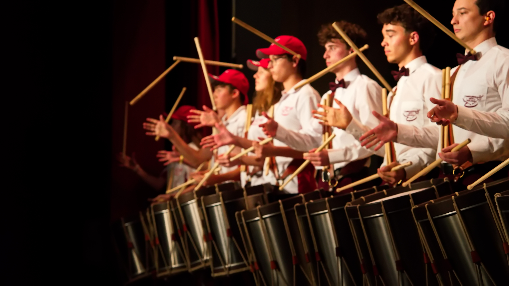
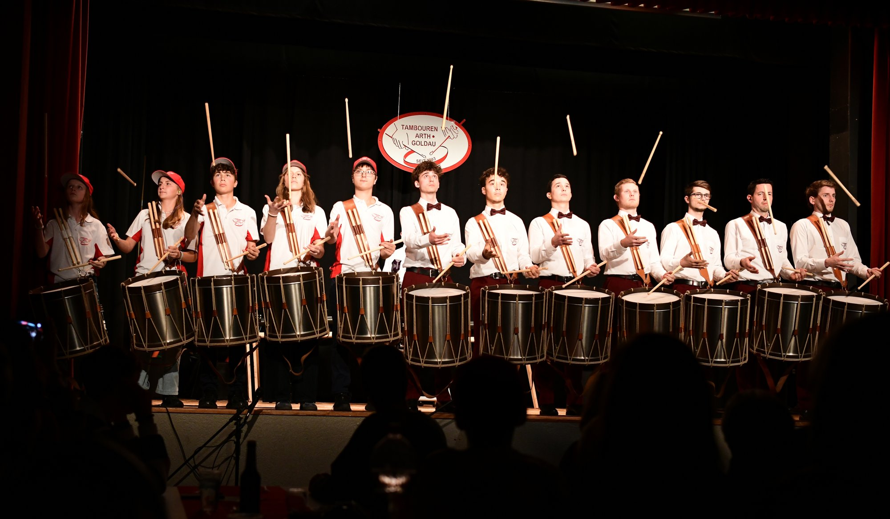
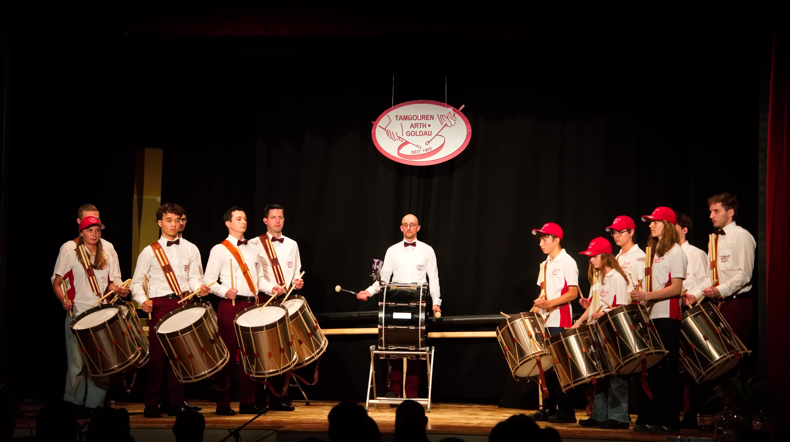

+++
date = '2026-10-26T09:00:00+01:00'
draft = false
title = 'Ein rhythmisches Feuerwerk zum 33. Geburtstag'
author = 'Guido Bürgler'
featured_image = '/posts/2026-10-26-33-jahre-jubilaeum/jubilaeum.jpg'
+++

# Ein rhythmisches Feuerwerk zum 33. Geburtstag

## Teil-Neuinstrumentierung des Tambourenvereins Arth-Goldau

**Mit einem fulminanten Jubiläumskonzert im vollbesetzten Georgsheim in Arth feierte der Tambourenverein Arth-Goldau sein Schnapszahl-Jubiläum. Zu Gast war die Ländlerformation BodäständiX, die zusammen mit den Jungtambouren das Publikum begeisterte.**

Der 1993 gegründete Tambourenverein Arth-Goldau blickt auf eine bewegte Geschichte voller Rhythmus, Kameradschaft und musikalischer Höhepunkte zurück. Was einst im kleinen Kreis begann, ist heute eine feste und unverzichtbare Grösse im kulturellen Leben der Gemeinde Arth.

### Vereinseigene Jungtambourenausbildung

Das Schnapszahl-Jubiläum wurde am Samstag im ausverkauften Georgsheim ausgiebig gefeiert. Am Konzert unter dem Motto «Jetzt rigleds» wurden 13 neu revidierte Trommeln vorgestellt. Diese stammen vom ehemaligen Tambourenverein Küssnacht. «Es sind gute Instrumente, mit denen die Jungtambouren gerne musizieren», meinte Vereinspräsident Kuno Bürgi zur RigiPost. Er betonte die hohe Bedeutung der vereinseigenen Ausbildung für die Nachwuchsförderung. «Die Musikschule ist das tragende Fundament für die Zukunft unseres Vereins», so Bürgi.

*Mit den 13 neu angeschafften Trommeln machte die anspruchsvolle Show sichtlich Freude. Bild: Guido Bürgler*

Die technische Leitung des anspruchsvollen Konzertes, das nicht nur musikalisch, sondern auch visuell beeindruckte, lag in den Händen von Philipp Gisler. Zur Aufführung gelangten unter anderem drei Eigenkompositionen, die Gisler zusammen mit Benj Fassbind geschrieben hatte. Dies waren der «Röhrenbeat», «Jonge Vlessen» und «Movin’ Cordon Bleu», bei welchem eine tolle Show mit präzisem taktvollem Schlägerwerfen gezeigt wurde. Ebenfalls für Begeisterung sorgte der «Röhrenbeat», der aus bekannten Technostücken arrangiert wurde, und für das Spiel mit Röhren umgeschrieben wurde. In der Formation «Special Force» traten auch ehemalige Tambouren auf.

### Ländlermusik mit Trommlerbegleitung

Im zweiten Konzertteil trat die versierte Ländlerformation «BodäständiX» auf. Sie interpretierte zusammen mit den Jungtambouren zum Beispiel das bekannte Stück «Zogä-n-am Bogä» und als Zugabe den Schottisch dr Rigitüüfel, wobei die jungen Tambouren mit ihren Chlefeli – statt Trommeln – den Rhythmus unterstützten. Anschliessend demonstrierten zwei junge Tanzpaare aus Illgau und Sisikon das in Innerschwyz bekannte «Gäuerlä» und «Bödälä» auf eindrückliche Weise. Mit spektakulären – «balzartigen» Sprüngen umwarben die Tänzer Michael Heinzer und Daniel Zwyer zum Takt der lüpfigen Musik ihre Tanzpartnerin. Diese überraschende Einlage zeigte dem Publikum auf wunderschöne Weise, wie eng die traditionelle «tänzige» Ländlermusik mit der taktvollen Musik der Tambouren verwandt ist. Dem Publikum gefiel das Gebotene ausgezeichnet, denn alle musikalischen Darbietungen wurden mit viel Applaus verdankt. Es forderte mit Nachdruck zwei Zugaben. Im Anschluss ans anderthalbstündige Konzert, an dem auch viele Familien anwesend waren, spielte BodäständiX zur Unterhaltung und zum Tanz auf. Das rundum gelungene Jubiläum hat gezeigt, dass der Tambourenverein Arth-Goldau auch nach 33 Jahren ein unverzichtbarer Eckpfeiler der regionalen Kulturszene ist.

Herzlichen Dank allen Besucherinnen und Besuchern, Helferinnen und Helfern sowie unseren Sponsoren für den gelungenen Abend!

<section class="relative py-12 md:py-16 my-8 overflow-hidden rounded-lg">
    

    
33

    

        

            
        

        

        

            
Schnappszahl-Jubiläum — <em class="text-white text-base font-bold not-italic">"jetzt rigleds"</em>

            <h2 class="!text-3xl lg:!text-4xl font-bold text-white !mt-2 !mb-0">33 Jahre Tambourenverein Arth-Goldau</h2>
            

                Abendprogramm mit <strong class="text-white">BodäständiX</strong>  —
                Anschliessend Festwirtschaft mit <strong class="text-white">BodäständiX – Mix</strong>
            

            

                

                    
Sa, 24. Oktober 2026

                    
19:30 Uhr · Festwirtschaft ab 18:30 Uhr

                

                

                

                    

                        <svg class="w-4 h-4 text-white/70" fill="currentColor" viewBox="0 0 20 20">
                            <path fill-rule="evenodd" d="M5.05 4.05a7 7 0 119.9 9.9L10 18.9l-4.95-4.95a7 7 0 010-9.9zM10 11a2 2 0 100-4 2 2 0 000 4z" clip-rule="evenodd"></path>
                        </svg>
                        <a href="https://www.google.com/maps/search/?api=1&query=Georgsheim+Arth" target="_blank" rel="noopener noreferrer" class="!text-white !no-underline hover:!underline">Georgsheim, Arth</a>
                    

                    
Tickets CHF 15 · Gönner CHF 33

                

            

            

                
            

        

    

</section>

<a href="https://photos.app.goo.gl/Q7sh1nn3kTAwud2w8" target="_blank" rel="noopener noreferrer" class="block w-full my-8 bg-white rounded overflow-hidden shadow-md hover:shadow-xl transition-shadow duration-300 !no-underline">
    
    

        
Fotogalerie

        
Alle Fotos vom 33-Jahre-Jubiläum des Tambourenvereins Arth-Goldau auf Google Photos

    

</a>
